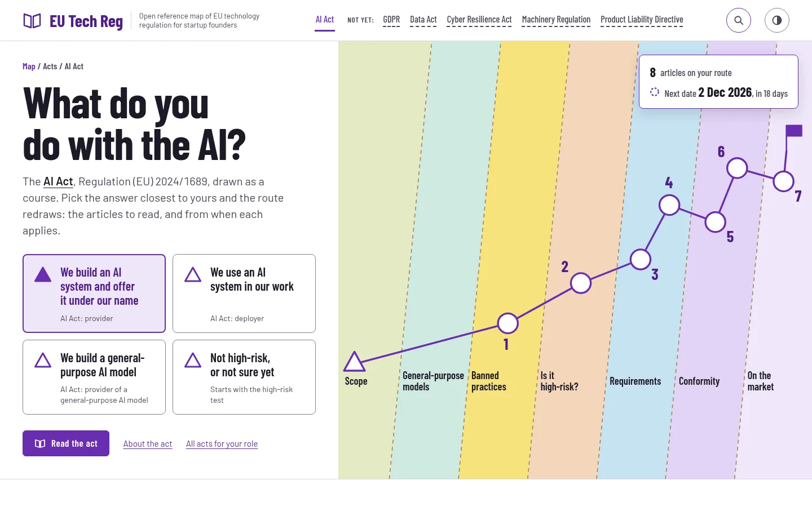
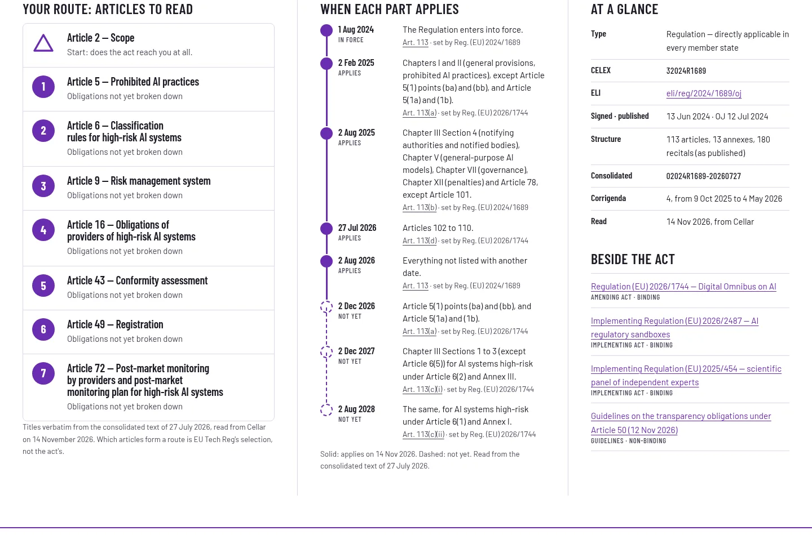
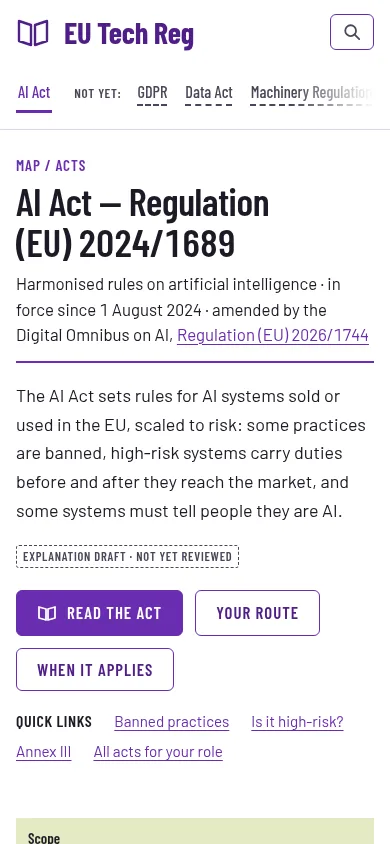

# 02 · Reading an act

## The top of the page

- **The title and status line** — the act's name and number, when it came into force, and the act
  that amended it (for the AI Act, the Digital Omnibus on AI, Regulation (EU) 2026/1744).
- **The opening paragraph** — the act in plain words. While nobody has reviewed it, it carries the
  label *Explanation draft · not yet reviewed*.
- **Read the act** — opens the consolidated text on EUR-Lex.

## The map and your route

The right half is the act as terrain, its stages as coloured bands. Choose your role in the
**Your route** box — *Provider* or *Deployer* on the AI Act — and the purple course redraws for it.

- The **start triangle** is Article 2, scope: whether the act reaches you at all.
- Each **numbered control** is an article to read; select one to jump to it in the list below.
- The **finish flag** ends the route.

The route is EU Tech Reg's selection of where to read, not the act's, and not a judgement about
you. Whether your system is high-risk, for example, is a test in Article 6 and Annex III that you
apply — the map shows you where it is.

## Below the map

- **Your route: articles to read** — the same articles as the map's controls, each title verbatim
  from the act and linked to EUR-Lex. *Obligations not yet broken down* means the duties inside the
  article have not been written out on the map yet; read the article itself.
- **When each part applies** — every date in the act's application article, each with the point it
  comes from and the act that set it. A **solid** line and dot: applies today. **Dashed**: not yet.
- **At a glance** — the act's identifiers (CELEX, ELI), when it was signed and published, its
  structure, its consolidated version, its corrigenda, and when the map read it.
- **Beside the act** — amending acts, implementing acts and guidelines, each marked binding or
  non-binding.

## On a phone

The map is redrawn top to bottom: the stages as rows, the course descending. The acts in the
masthead scroll sideways.
