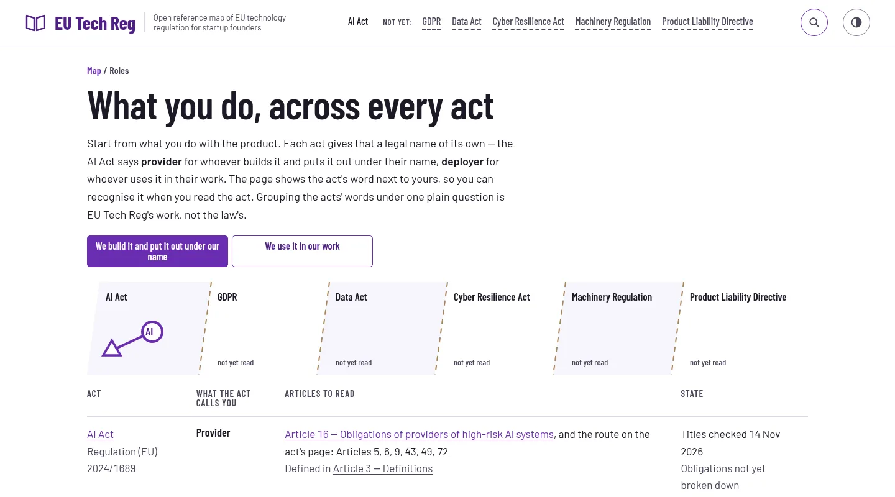

# 03 · Your role across every act

Every act names its roles in its own words: the AI Act speaks of *providers* and *deployers*, other
acts of *manufacturers*, *controllers*, *data holders*. A startup is often several at once.

This page groups them under a few shared roles — **Makes it**, **Uses it in their business** — so
one question reaches every act. The grouping is EU Tech Reg's, not the law's, and the act's own term
is always shown beside it.

## Reading it

- **The strip** — the six first acts side by side. Your course starts in the acts the map has read
  and continues **dashed** through those it has not.
- **The table** — for each act: the act's own term for your role, the articles to read, and where
  that term is defined.

An act's term appears only once it has been read from that act's definitions article. Until then
the row says *Not yet read* — the map does not fill anything in from memory.
