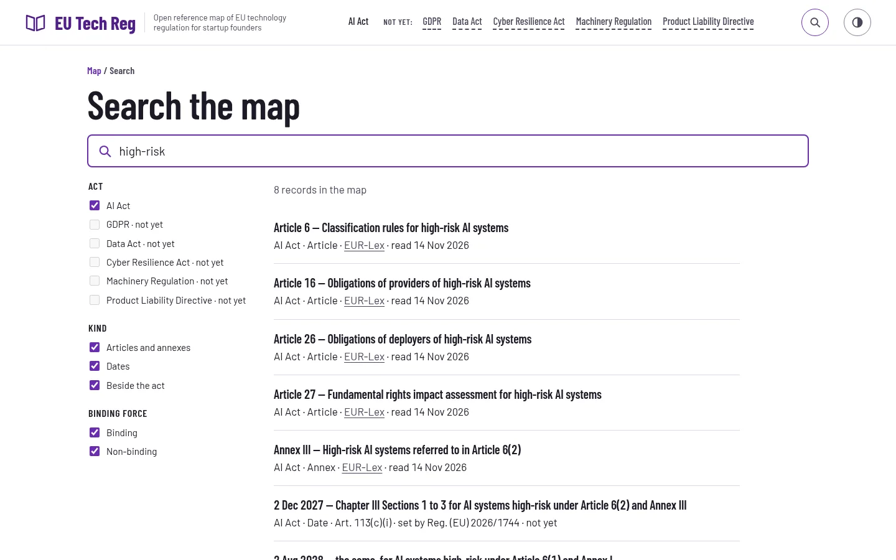

# 04 · Searching

Type a word or an article number. Results are **records** — an article, a date, an implementing act,
a guideline — not pages.

## Filters

- **Act** — acts not yet on the map are listed and marked *not yet*.
- **Kind** — articles and annexes, dates, documents beside the act.
- **Binding force** — binding (acts, implementing acts) or non-binding (guidelines).

On a phone the filters fold into **Filters** above the results.

## A result

The title, then one line: the act, the kind, a link to the text on EUR-Lex, and when the map read
it. A date result also names the act that set it and whether it applies yet.

If nothing matches, the page says what the map covers so far.

The site's search and an agent's search read the same index (planned): you and your agent find the
same records.
