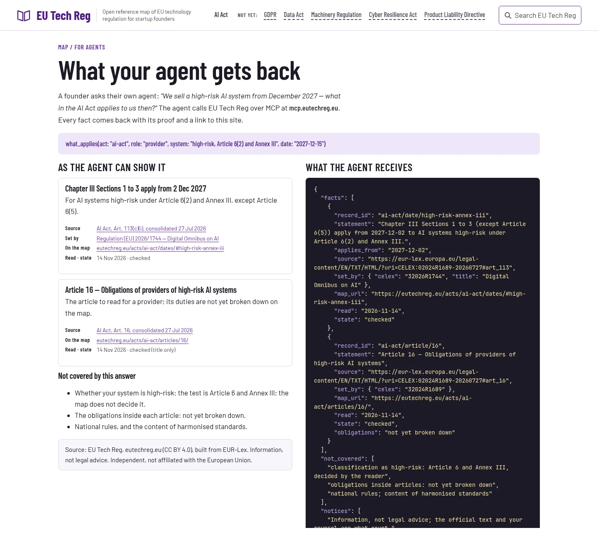

# 05 · Connecting your agent

**Planned.** The MCP server is designed but not built; this chapter describes what it will do, as
the mockup shows it.

## How it works

You connect your own agent to EU Tech Reg over MCP, at `mcp.eutechreg.eu`. There is no login: the
map is public. Your agent asks; the map answers with facts and their proof; your agent does the
reasoning.

Tools it will offer include `what_applies` (the acts and articles for a role on a date), `timeline`
(dates in a window), `find_acts`, `get_act`, `get_obligations`, `related`, `get_guidance` and `search`
(04 — Architecture, section 5).

## What comes back

Every fact carries:

| Field | What it is |
| --- | --- |
| `source` | The official text on EUR-Lex, to the article |
| `set_by` | The act that set it — the original, or an amending act such as the Digital Omnibus |
| `map_url` | A permanent link to the map's own page for this fact |
| `record_id` | Its stable id |
| `read`, `state` | When the map read it, and whether it is checked |
| `map_version` | Which version of the map answered |

Every answer also says **what it does not cover** — for example, whether your system is high-risk is
yours to decide — and carries both notices and an attribution line.

## Passing it on

When your agent quotes the map in a memo or to counsel, keep the `source` link (that is the proof)
and the `map_url` (that is the way back). The attribution line can be copied as is: the map's
records are CC BY 4.0.
